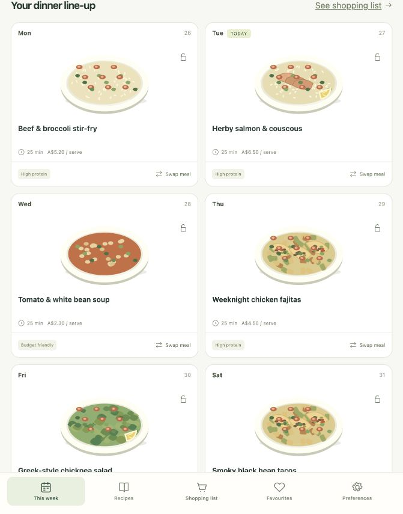

# Mealroom

A local meal planner for Home Assistant OS. Plan dinners around your household,
budget and dietary preferences, then shop from one combined ingredient list.

This is an independent implementation informed by a static inspection of the
installed Mise app. It does not contain Mise's code, recipe catalogue, images,
API credentials or branding. The starter recipes and SVG illustrations were
written for this project. See [the investigation and feature map](docs/investigation.md).



## What works

- Seven-day dinner plans with an estimated cost ceiling, dietary exclusions,
  maximum cooking time and equipment filters.
- Lock dinners before regenerating, swap individual meals, or choose them yourself.
- 24 editable starter recipes; add your own recipes and ingredient quantities.
- Household-scaled shopping lists with categories, checkboxes, pantry exclusions,
  extra groceries, printing and text export.
- Favourites, ratings, personal notes and step-by-step cooking.
- Persistent SQLite storage, plan history and JSON backup/restore.
- Home Assistant Ingress and sidebar access. One kitchen shared by HA users.
- Responsive interface with all scripts, styles, fonts and illustrations local.

## Install on Home Assistant OS

Mealroom is a **Home Assistant App**, previously called an add-on. **HACS does
not install Docker apps.** Use the App store's repository list instead.

### From a GitHub repository

[Add the Mealroom repository to Home Assistant](https://my.home-assistant.io/redirect/supervisor_add_addon_repository/?repository_url=https%3A%2F%2Fgithub.com%2Fduarte-hub%2Fmealroom-home-assistant),
or follow these steps:

1. Open **Settings → Apps → Install app** (on older HA versions,
   **Settings → Add-ons → Add-on store**).
2. Open the store's **⋮ → Repositories**, add `https://github.com/duarte-hub/mealroom-home-assistant`.
3. Refresh the store and select **Mealroom**. Choose **Install**. The Supervisor
   builds the container locally, so the first install may take a few minutes.
4. Set first-run options if desired, start the app, then choose **Open Web UI**.
5. Enable **Show in sidebar** and **Start on boot**.

This repository supports `amd64` and `aarch64` hosts. No prebuilt image is
required; Home Assistant builds the app from its Dockerfile. The local package
installation below is an alternative to adding the repository.

### Install the local package

1. Unzip the provided source archive on your computer.
2. Copy the **meal_planner** folder, including `config.yaml` and `Dockerfile`,
   into Home Assistant's `/addons` directory, giving `/addons/meal_planner`.
   Use your existing Samba or SSH access to the HA OS host's local app folder.
   This is not `/config/addons`; if your current file-sharing app exposes only
   `/config`, use access that exposes `/addons`.
3. Reload the App store. Mealroom appears under **Local apps** (formerly
   **Local add-ons**). Install, start and open its Web UI.

The installer needs outbound access to Docker Hub, the Alpine package repository
and PyPI when building. The running meal planner needs no Internet connection.

## First-run options

| Option | Default | Meaning |
| --- | --- | --- |
| `household` | `2` | People at the table, 1–12 |
| `weekly_budget` | `120` | Weekly **dinner** budget, in currency units |
| `shop` | `Coles` | Label used on the shopping list |

These initialise a new kitchen only. Use **Preferences inside Mealroom** for
later changes. Starter costs are rough AUD estimates. Choosing another currency
changes the display; it does not convert amounts. Edit recipe costs to match
your own local prices. No live retailer prices, stock checks or checkout
integrations are included.

## Using the app

1. Open **Preferences**, choose your household size, dinner budget, dietary
   preference, ingredients to avoid and equipment.
2. Open **This week → Plan my week**. A plan never silently ignores hard filters
   or exceeds the requested estimate budget. If it cannot fit seven dinners,
   the app asks you to change the constraints. With limited choices, recipes
   may repeat and the app says so.
3. Use the lock icon to keep a dinner during regeneration. Locked dinners are
   explicit exceptions to changed preferences and count toward the budget.
4. Open **Shopping list** to check ingredients off. The leaf icon moves an
   ingredient to your persistent pantry. Extra groceries do not count toward
   the dinner estimate. Regenerating, changing recipes or changing the household
   size clears checkmarks because quantities may have changed.
5. Tap a recipe to see scaled ingredients, cook, rate it or save notes. Ingredient
   scaling does not rewrite quantities embedded in free-text instructions.

The planner prefers variety and favoured recipes, using independently written
randomised selection. It is not a reconstruction of Mise's exact scoring
formula. Dietary filters use recipe metadata: check ingredient packaging and
label recipes you add correctly.

## Data and access

- Data is saved to `/data/mealroom.sqlite3` inside the app's persistent volume.
  Updates preserve it. Supervisor app backups include this volume by default.
- **Preferences → Download backup** exports a portable JSON backup. Restore
  validates it before replacing the current kitchen; invalid imports leave the
  database unchanged. Download a backup before a valid restore.
- All users with access to the Home Assistant app share the same kitchen and
  can edit it. There are no separate per-person accounts or permissions.
- In HA mode, the server accepts app requests only from the Supervisor's
  ingress address, `172.30.32.2`. No host port, HA API token, privileged mode or
  device access is requested. Loopback health probes are permitted.
- Mutating requests require a page-issued CSRF header. The server runs as an
  unprivileged account after the entrypoint prepares the app's data volume.

## Standalone Docker

From the repository root:

```sh
docker compose up -d --build
```

Open `http://127.0.0.1:8099`. The compose file binds to loopback; this standalone
mode has no login and is intended for local use. Its named volume persists data.
Do not pass `INGRESS_ONLY=true` in standalone mode: that setting expects the
Supervisor's actual network peer, not a forwarded header.

## Develop and verify

Python 3.13+ is recommended. From the repository root:

```sh
python3 -m venv .venv
.venv/bin/pip install -r meal_planner/requirements.txt
DATA_DIR=./data HOST=127.0.0.1 .venv/bin/python meal_planner/run.py
```

```sh
.venv/bin/python -m unittest discover -s tests -v
node --check meal_planner/static/app.js
```

GitHub Actions tests the backend and builds/smoke-tests the amd64 container.
Actual Home Assistant installation and aarch64 execution still require testing
on those hosts. The initial version was tested natively on macOS; Docker was
not available on the development Mac.

## Scope

The first version covers local dinner planning, recipes and shopping. It does
not implement Mise's subscription system, analytics, cloud account recovery,
invite codes, push notifications, nutrition calculations, retailer feeds or
its large regional recipe catalogue. Household sharing here uses one local
database behind Home Assistant authentication.

## References

- [Home Assistant App ingress](https://contributors.home-assistant.io/apps/guides/ingress/)
- [App configuration](https://contributors.home-assistant.io/apps/reference/configuration/)
- [HACS and add-ons](https://hacs.dev/docs/faq/addons/)

## Licence

The independently written app code, starter recipes and SVG assets are MIT
licensed. Mise and Home Assistant remain the property of their respective
owners. This project is not affiliated with Mise.
